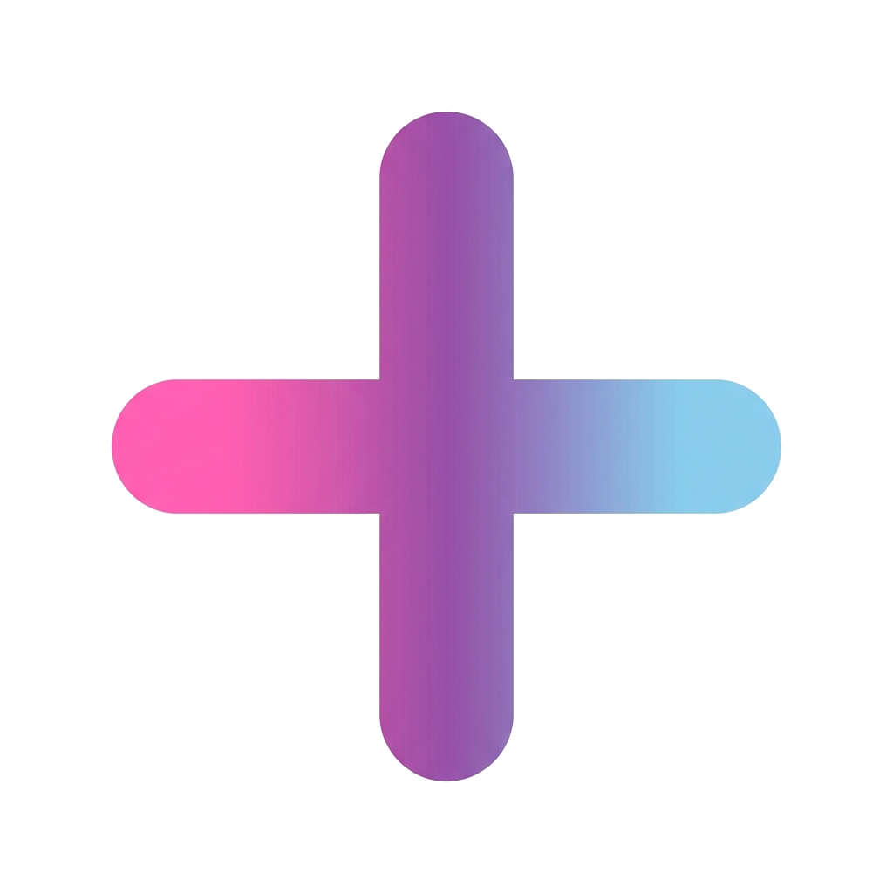

<p align="center">
  
</p>

<p align="center">
  <b>✨ An Anime-Themed Operating System Built From Scratch ✨</b>
</p>

<p align="center">
  <a href="https://github.com/Koharu81/StellaOS/actions/workflows/build.yml">
    
  </a>
  <a href="https://github.com/Koharu81/StellaOS/releases/latest">
    
  </a>
  <a href="https://github.com/Koharu81/StellaOS/blob/main/LICENSE">
    
  </a>
  
  
  
</p>

---

## 🌟 What is StellaOS?

**StellaOS** (ステラOS) is a custom operating system built entirely from scratch — no Linux, no BSD, no existing OS kernel. It features a beautiful anime/otaku-themed desktop environment with a modern UI inspired by Windows 11 and macOS, heavy optimization, and support for 32+ languages.

> **"Stella"** means "Star" ⭐ — your starlit desktop experience.

---

## ✨ Features

### 🎨 Desktop Environment
- 🪟 **Rounded corner windows** — macOS-style window controls (close/minimize/maximize)
- 📊 **Floating taskbar** — centered app icons, rounded corners, hover animations
- 🌸 **Anime-themed UI** — sakura pink & purple color scheme throughout
- ✨ **Animated sparkle cursor** — custom star-shaped mouse cursor
- 🖼️ **8+ procedural wallpapers** — Starry Night, Sakura Dream, Aurora, Galaxy, and more
- 🌓 **Desktop widgets** — analog clock, calendar, system info, weather
- 🔔 **Notification system** — toast-style popups
- 📋 **Right-click context menus**
- 🔒 **Lock screen** with sparkle animations
- 💥 **Kawaii crash screen** — cute error handling with "(╥_╥)"

### 🖥️ Built-in Applications
| App | Description |
|-----|-------------|
| 🖳 **Terminal** | Command-line with `help`, `sysinfo`, `neofetch`, `stella` commands |
| ⚙️ **Settings** | Language selector, theme display, system information |
| 📁 **File Manager** | Browse virtual filesystem with anime-themed entries |
| ℹ️ **About** | System info, version, credits |
| 🧮 **Calculator** | Full calculator with button grid and keyboard input |
| 📝 **Text Editor** | Line numbers, cursor, syntax coloring |
| 🎨 **Paint** | Drawing canvas with 12 colors and brush sizes |
| 🐍 **Snake Game** | Classic snake with pink gradient and star food |
| 📊 **System Monitor** | Memory graphs, CPU usage, task list |

### ⚡ System
- 🔧 **Custom kernel** — GDT, IDT, ISR/IRQ, PIT timer, PIC
- 💾 **Memory management** — bitmap physical allocator + heap (kmalloc/kfree)
- ⌨️ **PS/2 keyboard** driver with full US layout
- 🖱️ **PS/2 mouse** driver with button tracking
- 💽 **ATA/IDE** disk driver (PIO mode)
- 🔌 **PCI bus** enumeration
- ⏰ **RTC** real-time clock
- 🔋 **ACPI** power management (shutdown/reboot)
- 📋 **Clipboard** system
- 🗂️ **Virtual Filesystem** (VFS) with ramfs
- ⚙️ **Cooperative scheduler** with priority levels
- 🔄 **System calls** via int 0x80
- 📡 **Network stack** (stub for future expansion)
- 🔊 **Serial debug** output (COM1)

### 🌏 Internationalization
32+ languages supported including:
`English` `한국어` `日本語` `中文(简)` `中文(繁)` `Español` `Français` `Deutsch` `Italiano` `Português` `Русский` `العربية` `हिन्दी` `ไทย` `Tiếng Việt` `Bahasa Indonesia` `Türkçe` `Polski` `Nederlands` `Svenska` `Norsk` `Dansk` `Suomi` `Čeština` `Magyar` `Română` `Ελληνικά` `Български` `Українська` `עברית` `Bahasa Melayu` `Filipino`

---

## 📥 Download & Install

### Quick Download
👉 **[Download Latest ISO from Releases](https://github.com/Koharu81/StellaOS/releases/latest)** 👈

### Run with QEMU (Quickest)
```bash
qemu-system-i386 -cdrom StellaOS.iso -m 256M -vga std
```

### Run with VirtualBox
See the detailed VM setup guide in the Wiki or ask the developer.

---

## 🔨 Build From Source

### Prerequisites (Ubuntu/Debian)
```bash
sudo apt-get update
sudo apt-get install -y nasm gcc gcc-multilib make xorriso grub-pc-bin grub-common mtools
```

### Build
```bash
git clone https://github.com/Koharu81/StellaOS.git
cd StellaOS
make all
```

The ISO will be at `build/StellaOS.iso`.

---

## 🖼️ Wallpapers

StellaOS includes 8 beautiful procedural animated wallpapers built into the OS, plus a wallpaper downloader script to fetch 4K anime wallpapers:

```bash
# Download 20 4K anime wallpapers from Wallhaven
bash scripts/download_wallpapers.sh 20

# PowerShell version
.\scripts\download_wallpapers.ps1 -Count 20
```

---

## 📁 Project Structure
```
StellaOS/
├── boot/grub/          # GRUB bootloader config
├── include/            # Header files (~30+ headers)
├── kernel/             # Kernel source (~40+ C/ASM files)
│   ├── boot.asm        # Multiboot2 entry point
│   ├── kernel.c        # Main kernel initialization
│   ├── gdt.c/idt.c     # CPU descriptor tables
│   ├── isr.c/irq.c     # Interrupt handling
│   ├── memory.c        # Physical + heap memory manager
│   ├── framebuffer.c   # Double-buffered framebuffer
│   ├── graphics.c      # 2D drawing primitives
│   ├── font.c          # 8x16 bitmap font renderer
│   ├── gui.c           # Window manager & desktop
│   ├── apps.c          # Terminal, Settings, File Manager, About
│   ├── calculator.c    # Calculator app
│   ├── snake.c         # Snake game
│   ├── paint.c         # Paint app
│   ├── editor.c        # Text editor
│   ├── sysmon.c        # System monitor
│   ├── wallpaper.c     # Wallpaper manager
│   ├── scheduler.c     # Task scheduler
│   ├── vfs.c           # Virtual filesystem
│   ├── pci.c           # PCI bus driver
│   ├── ata.c           # ATA/IDE disk driver
│   ├── rtc.c           # Real-time clock
│   ├── acpi.c          # ACPI power management
│   ├── i18n.c          # 32 language translations
│   ├── installer.c     # OS installer wizard
│   └── ...
├── assets/             # Wallpapers, logo, icons
├── scripts/            # Build & download scripts
├── .github/workflows/  # CI/CD pipelines
├── Makefile            # Build system
├── linker.ld           # Linker script
├── LICENSE             # MIT License
└── README.md           # This file
```

---

## 🤝 Contributing

StellaOS is open source! Contributions welcome:

1. Fork the repository
2. Create a feature branch: `git checkout -b feature/amazing-feature`
3. Commit your changes: `git commit -m 'Add amazing feature'`
4. Push to the branch: `git push origin feature/amazing-feature`
5. Open a Pull Request

---

## 📄 License

This project is licensed under the **MIT License** — see [LICENSE](LICENSE) for details.

---

<p align="center">
  Made with ★ by the <a href="https://github.com/Koharu81/StellaOS">StellaOS Project</a>
</p>
<p align="center">
  <i>~ Your starlit desktop awaits ~</i>
</p>
